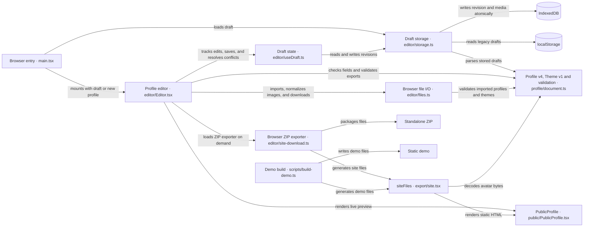

# Rvnce architecture

Rvnce uses one versioned profile document for browser editing, local drafts,
and published pages. The arrows show which component calls or uses another,
or where a component writes its output.



## Boundaries

- **Profile and theme.** [ProfileDocument](src/profile/document.ts) v4 contains
  profile details, ordered links, appearance, an optional credit and a browser
  tab icon. A theme v1 file carries only appearance and its background. Profile
  v1 and v2 migrate to Graphic with the original palette, accent and disabled
  credit. Profile v3 preserves its branding with an empty tab icon. Draft
  validation allows incomplete content. ZIP export validates a complete profile.
- **Editor.** [Editor](src/editor/Editor.tsx) owns the draft, preview and asset
  URLs. Browser file I/O validates and decodes imports before applying them.
  IndexedDB writes the draft revision and updated media atomically.
  BroadcastChannel reports changes to other editors, and each write checks
  the stored revision. The legacy localStorage value can still be recovered.
- **Public page.** [PublicProfile](src/public/PublicProfile.tsx) renders a
  validated profile with supplied asset URLs. [siteFiles](src/export/site.tsx)
  uses the same renderer and CSS variables to generate HTML, CSS and relative
  assets for demos and ZIP exports. Motion backgrounds carry a local
  playback script and a poster. All profile content remains available with
  scripting disabled.

## Local code graph

Run the official [Graphify](https://github.com/Graphify-Labs/graphify) CLI from
the repository root. The Python distribution is named `graphifyy`.

```sh
graphify extract . --code-only
graphify cluster-only . --no-label
```

Open `graphify-out/graph.html` for the interactive graph.
`graphify-out/GRAPH_REPORT.md` summarizes the extraction, and
`graphify-out/graph.json` contains the graph used by `graphify query`,
`graphify path`, and `graphify explain`. Run the commands again after changing
the source. The extraction uses the local AST and skips documents and images.
Generated graph files are ignored by Git.
