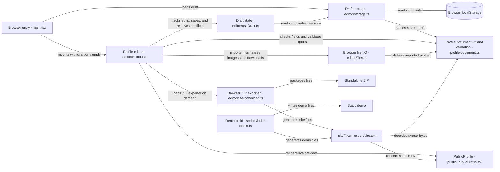

# Rvnce architecture

Rvnce uses one versioned profile document for browser editing, local drafts,
and published pages. The arrows show which component calls or uses another,
or where a component writes its output.



## Boundaries

- **Profile and draft.** [ProfileDocument](src/profile/document.ts) defines
  schema version 2, including profile details, page language, appearance, and
  ordered link blocks. Version 1 profiles are upgraded with the language
  `en`. JSON backup, import, and browser storage use draft validation so
  incomplete fields can be restored. ZIP export validates the complete profile.
- **Editor.** [Editor](src/editor/Editor.tsx) owns the draft and preview state.
  [Browser file I/O](src/editor/files.ts) validates imported JSON and decodes
  its avatar before the editor prompts for confirmation. A confirmed import
  replaces the draft through the same save path as ordinary edits. The
  [draft state](src/editor/useDraft.ts) batches saves and pauses writes when
  the stored revision changes. The live preview omits incomplete links and
  displays complete links as static content.
- **Public page.** [PublicProfile](src/public/PublicProfile.tsx) renders the
  supplied profile and avatar URL. [siteFiles](src/export/site.tsx) uses that
  component to produce HTML, CSS, and local assets with relative paths. The
  browser [ZIP exporter](src/editor/site-download.ts) re-encodes the avatar and packages those files, and
  the [demo build](scripts/build-demo.ts) writes the same file layout to a
  directory. Published profile pages run without JavaScript.

## Local code graph

Run the official [Graphify](https://github.com/Graphify-Labs/graphify) CLI from
the repository root. The Python distribution is named `graphifyy`.

```sh
graphify extract . --code-only
graphify cluster-only . --no-label
```

Open `graphify-out/graph.html` for the interactive graph.
`graphify-out/GRAPH_REPORT.md` summarizes the extraction, and
`graphify-out/graph.json` contains the graph used by `graphify query`,
`graphify path`, and `graphify explain`. Run the commands again after changing
the source. The extraction uses the local AST and skips documents and images.
Generated graph files are ignored by Git.
