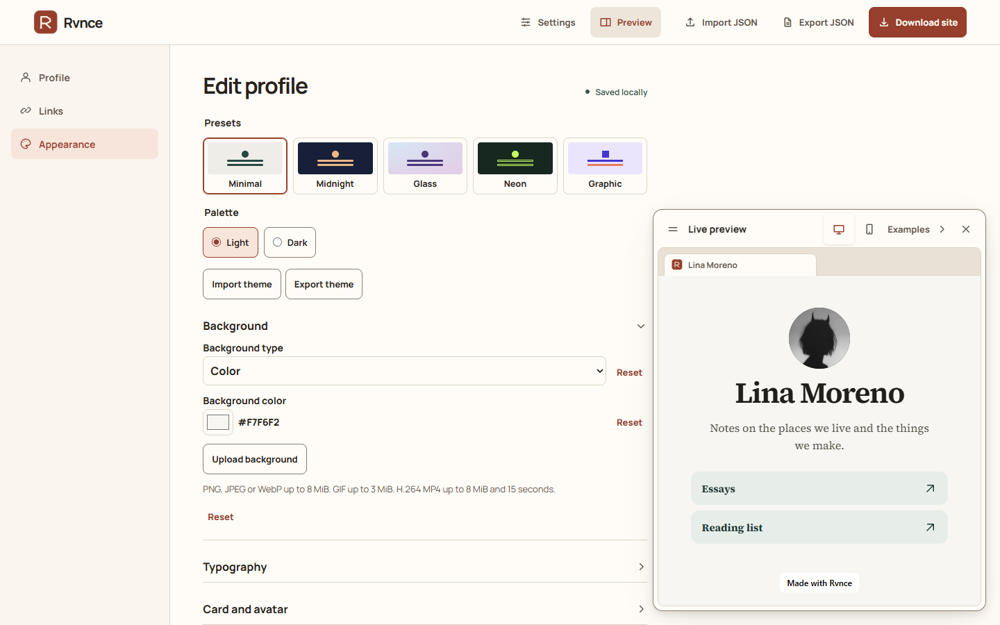
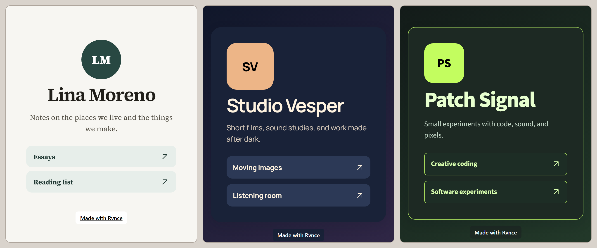

# Rvnce

[English](README.md) · [Русский](README.ru.md)

Rvnce is an open-source editor for personal bio pages. Start with a preset, make it yours, and download a standalone site you can host yourself.

[Open the editor](https://sinzbtw.github.io/rvnce/) · [Graphic](https://sinzbtw.github.io/rvnce/demo/) · [Minimal](https://sinzbtw.github.io/rvnce/demo/minimal/) · [Midnight](https://sinzbtw.github.io/rvnce/demo/midnight/) · [Glass](https://sinzbtw.github.io/rvnce/demo/glass/) · [Neon](https://sinzbtw.github.io/rvnce/demo/neon/)

## Make a profile

1. In **Profile**, add a name, bio, page language, photo, and an optional **Browser tab icon**. A PNG, JPEG, or WebP icon is fitted into a 64 × 64 PNG and included in the exported site. **Show Made with Rvnce** is on for new profiles and can be turned off or on at any time.
2. In **Links**, add up to 24 destinations. Button links and icon links are ordered separately. Icon links detect supported sites and can use a custom image in its original colors or tinted to the profile palette.
3. In **Appearance**, choose a preset and a light or dark palette. Background, page overlay, click effects, name effects, cursor and trail, and the profile entrance can be adjusted in their own preview dialogs. Enable name sparkles and text styling independently. **Examples** opens published profiles in separate tabs.
4. Download **Export JSON** for a full backup, **Export theme** to share just the appearance and its background, or **Download site** to publish.

Open **Settings** in the header to choose the editor language or the **System**, **Light**, or **Dark** editor theme. Rvnce remembers both choices in your browser. On a desktop, use the sidebar to switch sections and open **Preview** from the header when needed. You can drag the floating preview or move it with the arrow keys. On a phone, switch between **Editor** and **Preview**. The interface respects your reduced-motion preference.

Rvnce saves one draft per browser origin. If another tab changes the draft, export your current edits before loading the saved version. If browser storage is unavailable, download a JSON backup before closing the editor.

## Backgrounds and backups

- Choose a color, linear or radial gradient, PNG, JPEG, WebP, GIF, or H.264 MP4. Photo uploads can be up to 8 MiB and are resized to fit the site. GIFs can be up to 3 MiB and 240 frames. MP4s can be up to 8 MiB in any duration. Both motion formats are limited to 1920 × 1080.
- A motion background includes a still poster and a stop or play button. The page starts with the poster when the visitor prefers reduced motion or playback is blocked. If the editor cannot open a local MP4, it lets you upload a poster image for it. GIF and MP4 files are included as uploaded, including any metadata or embedded audio. Background video plays muted.
- Profile and theme JSON files can be up to 16 MiB. Backups use profile schema v5 and theme schema v2. Profiles v1–v4 and themes v1 import with the new effects off. Version 1 and 2 profiles keep their Graphic styling and disabled credit, and v1 profiles receive the original default language, `en`.
- Cursor and link icon images accept PNG, JPEG, or WebP up to 4 MiB. Rvnce converts them to PNG and fits them within 32 × 32 and 64 × 64 pixels respectively.

[Watch a short editor walkthrough](docs/images/appearance.gif).

## Run locally

Use Node.js 24 and npm.

    npm ci
    npm run dev

For a production build and a local preview:

    npm run build
    npm run preview

Serve `dist/` at the root or under a subpath to host the editor and examples.

## Publish a profile

Choose **Download site**, extract the ZIP, and upload all the files in it to your static host. Keep `index.html`, `profile.css`, `.nojekyll`, the fonts, and any profile assets together.

For GitHub Pages, upload the extracted files to the root of your profile repository. Under **Settings → Pages**, choose **Deploy from a branch**, select the branch and **`/ (root)`**, then open the URL that GitHub shows. The relative paths also work under a project subpath.

The exported page needs no server code and makes no requests to the editor. Text, links, static backgrounds, and the optional credit work without JavaScript. Animated backgrounds, click effects, and cursor trails use local scripts. A motion background shows its poster when scripting is off. The page respects the visitor’s reduced-motion preference.

## Development and license

Rvnce uses Preact, TypeScript, Vite, and Motion for editor animations. The editor preview, sample pages, and site exporter share the same public profile renderer. Vitest covers documents and export logic. Playwright runs against the built editor and exported pages.

See [Architecture](ARCHITECTURE.md), [Contributing](CONTRIBUTING.md), [Roadmap](ROADMAP.md), and [Security](SECURITY.md).

The source and original Rvnce mark are licensed under [MIT](LICENSE). Motion uses the [MIT license](https://github.com/motiondivision/motion/blob/main/LICENSE.md). Manrope, Source Sans 3, and Source Serif 4 use the SIL Open Font License. Each exported profile includes the selected family's license in `fonts/OFL.txt`.
