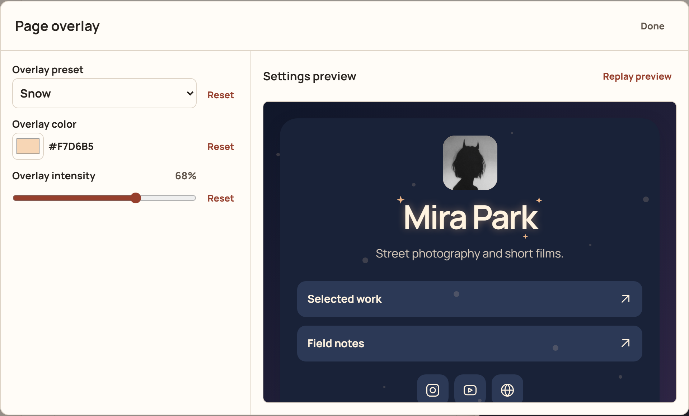

# Rvnce

[English](README.md) · [Русский](README.ru.md)

Rvnce — открытый конструктор персональных био-страниц. Соберите страницу со своими работами и ссылками, посмотрите на неё глазами посетителя и скачайте статический сайт для самостоятельной публикации.

**[Открыть редактор](https://sinzbtw.github.io/rvnce/)**

[Собрать профиль](#как-собрать-профиль) · [Запустить локально](#локальный-запуск) · [Опубликовать](#как-опубликовать-профиль) · [Участвовать в разработке](CONTRIBUTING.md)

## Готовые профили

- В **Minimal** спокойная палитра и шрифт с засечками подходят для авторской страницы. [Открыть профиль Лины Морено](https://sinzbtw.github.io/rvnce/demo/minimal/)
- В **Midnight** тёмный градиент и тёплые акценты оформляют страницу студии кино и звука. [Открыть Studio Vesper](https://sinzbtw.github.io/rvnce/demo/midnight/)
- В **Neon** контрастные зелёные контуры выделяют работы по креативному программированию. [Открыть Patch Signal](https://sinzbtw.github.io/rvnce/demo/neon/)

Ещё два примера. [Graphic](https://sinzbtw.github.io/rvnce/demo/) · [Glass](https://sinzbtw.github.io/rvnce/demo/glass/)

## Как собрать профиль

1. **Настройте.** В разделе **Профиль** добавьте имя, описание, язык страницы и фото. В разделе **Ссылки** можно добавить до 24 адресов и отдельно менять порядок кнопок и иконок. Для известных сайтов иконка определяется автоматически. Загруженное изображение можно оставить в исходных цветах или окрасить в цвет профиля. В разделе **Оформление** выберите пресет и настройте фон, шрифты, карточку, аватар, кнопки и эффекты.
2. **Проверьте.** Откройте **Превью** и переключайтесь между настольным и мобильным режимами. В меню **Примеры** доступны опубликованные профили. У фона, появления профиля, курсора и следа, эффекта поверх страницы, клика и имени есть свои окна с предпросмотром. Щёлкните или переместите указатель в предпросмотре, чтобы опробовать эффекты. Искры вокруг имени и оформление текста включаются независимо.
3. **Скачайте.** Выберите **Экспорт JSON** для полной копии, **Экспорт темы** для переноса оформления с его файлами или **Скачать сайт**, чтобы получить готовый ZIP для публикации.

В разделе **Эффект поверх страницы** доступны «Глитч» с настройкой частоты, «Матричный дождь» с настройкой плотности, «Пыль на плёнке» и «Летящие угольки». Эффекты не перекрывают ссылки и учитывают настройку уменьшенного движения.

Снег, плавающие частицы, искры вокруг имени и анимированный градиент движутся непрерывно, пока включены. Плёночное зерно добавляет мелкую статичную текстуру. Волна, выброс частиц и искры от клика постепенно исчезают.

В разделе **Курсор и след** можно попробовать пиксельную стрелку, неоновый указатель и точный прицел. Выбранный курсор входит в экспорт сайта. Свой курсор по-прежнему можно загрузить в PNG. Следы постепенно исчезают после остановки указателя.

В разделе **Эффекты имени** свечение и анимированный градиент можно сочетать с печатной машинкой, мягкой пульсацией или появлением по буквам. Настройте скорость и нажмите **Повторить предпросмотр**, чтобы увидеть анимацию снова. Программы чтения с экрана сразу получают полное имя, а при уменьшенном движении имя сразу видно целиком.

В разделе **Типографика** можно выбрать встроенный шрифт с засечками, без засечек, моноширинный или акцидентный, загрузить WOFF2 до 1 МиБ или указать прямой HTTPS-адрес WOFF2. Загруженный файл входит в ZIP. Шрифт по URL загружается с сервера поставщика, который должен разрешать запросы с других сайтов. Если шрифт недоступен или в нём нет символа, используется системный шрифт.

Форма редактора занимает всю доступную ширину рядом с боковым меню, а при открытии плавающего превью освобождает для него место. В окнах настроек предпросмотр подстраивается по высоте под содержимое профиля, а длинные профили можно прокручивать.

В разделе **Профиль** также можно добавить **иконку вкладки** и переключить подпись **Сделано в Rvnce**, которая включена для новых профилей. Иконка из PNG, JPEG или WebP вписывается в PNG 64 × 64 и добавляется в экспорт сайта.

В разделе **Анимация заголовка вкладки** можно выбрать печатную машинку или прокрутку и настроить скорость. В редакторе анимация видна на макете вкладки, а после экспорта она меняет заголовок настоящей вкладки. Заголовок остаётся статичным, когда опция выключена или выбрано уменьшенное движение.

Откройте **Настройки** в шапке, чтобы выбрать язык редактора и системную, светлую или тёмную тему. Rvnce запоминает оба выбора в браузере. На компьютере разделы находятся слева, а **Превью** открывается из шапки. Плавающее окно можно перетащить или переместить клавишами со стрелками. На телефоне доступны вкладки **Редактор** и **Превью**. Интерфейс учитывает настройку уменьшенного движения.

Rvnce хранит один черновик на origin браузера. Если другая вкладка изменила черновик, скачайте свои правки перед загрузкой сохранённой версии. Если хранилище недоступно, скачайте JSON перед закрытием редактора.

## Фоны и резервные копии

- Доступны цвет, линейный и радиальный градиенты, PNG, JPEG, WebP, GIF и H.264 MP4. Изображения до 8 МиБ масштабируются под сайт. GIF ограничен 3 МиБ и 240 кадрами. MP4 может быть любой длительности и весить до 8 МиБ. Предельное разрешение для GIF и видео — 1920 × 1080.
- У движущегося фона есть статичный постер и кнопка запуска или остановки. Если посетитель включил уменьшение движения или браузер заблокировал автозапуск, сначала виден постер. Если редактор не может открыть локальный MP4, можно загрузить изображение для постера. GIF и MP4 входят в экспорт с исходными метаданными и звуковой дорожкой, если она есть. Видео на странице играет без звука.
- Размер JSON профиля или темы ограничен 16 МиБ. Резервные копии используют схему профиля v8 и темы v4. В импортированных профилях v1–v6 заголовок вкладки остаётся статичным. У профилей v5 и тем v2 сохраняются эффекты оформления, а анимация имени выключена. При импорте профилей v1–v4 и тем v1 новые эффекты выключены, а прежние ссылки остаются кнопками. У профилей v1 и v2 сохраняется графичное оформление с выключенной подписью. Для v1 используется прежний язык по умолчанию `en`.
- Курсоры и иконки ссылок можно загрузить в PNG, JPEG или WebP до 4 МиБ. Rvnce преобразует их в PNG размером до 32 × 32 и 64 × 64 пикселей соответственно.

## Локальный запуск

Понадобятся Node.js 24 и npm.

    npm ci
    npm run dev

Сборка для публикации и локальный предпросмотр:

    npm run build
    npm run preview

Чтобы разместить редактор и примеры, загрузите содержимое `dist/` в корень или подпапку статического хостинга.

## Как опубликовать профиль

Нажмите **Скачать сайт**, распакуйте ZIP и загрузите все файлы на статический хостинг. Держите рядом `index.html`, `profile.css`, `.nojekyll`, шрифты и медиа профиля.

На GitHub Pages положите файлы в корень репозитория профиля. В **Settings → Pages** выберите **Deploy from a branch**, укажите ветку и **`/ (root)`**, затем откройте адрес, который покажет GitHub. Относительные пути работают и в подпапке проекта.

Опубликованная страница обходится без серверного кода и не обращается к редактору. Текст, ссылки, статичные фоны и подпись работают без JavaScript. Движущийся фон, эффекты клика и след курсора используют локальные скрипты. При отключённых скриптах у движущегося фона остаётся постер. Страница учитывает настройку уменьшенного движения.

## Разработка и лицензия

Rvnce использует Preact, TypeScript, Vite и Motion для анимаций редактора. Предпросмотр, примеры и экспорт используют общий рендерер профиля. Vitest проверяет документы и экспорт, а Playwright — собранный редактор и опубликованные страницы.

См. [архитектуру](ARCHITECTURE.md), [участие в разработке](CONTRIBUTING.md), [планы развития](ROADMAP.md) и [безопасность](SECURITY.md).

Код и оригинальный знак Rvnce распространяются по лицензии [MIT](LICENSE). Motion использует [лицензию MIT](https://github.com/motiondivision/motion/blob/main/LICENSE.md). Manrope, Inter, Source Sans 3, Source Serif 4, Roboto Mono и Oswald распространяются по SIL Open Font License. В экспорт со встроенным шрифтом входит его лицензия в `fonts/OFL.txt`. Используйте свои шрифты только с правом на публикацию.

Для редактора и обычных ссылок используются иконки Lucide. Логотипы соцсетей взяты из Font Awesome Brands по лицензии CC BY 4.0 и окрашены в цвет ссылок профиля. Лицензии обеих библиотек входят в экспорт в папке `icons/`. [Лицензия Lucide](https://github.com/lucide-icons/lucide/blob/1.79.0/LICENSE) · [Лицензия Font Awesome Free](https://fontawesome.com/license/free)
