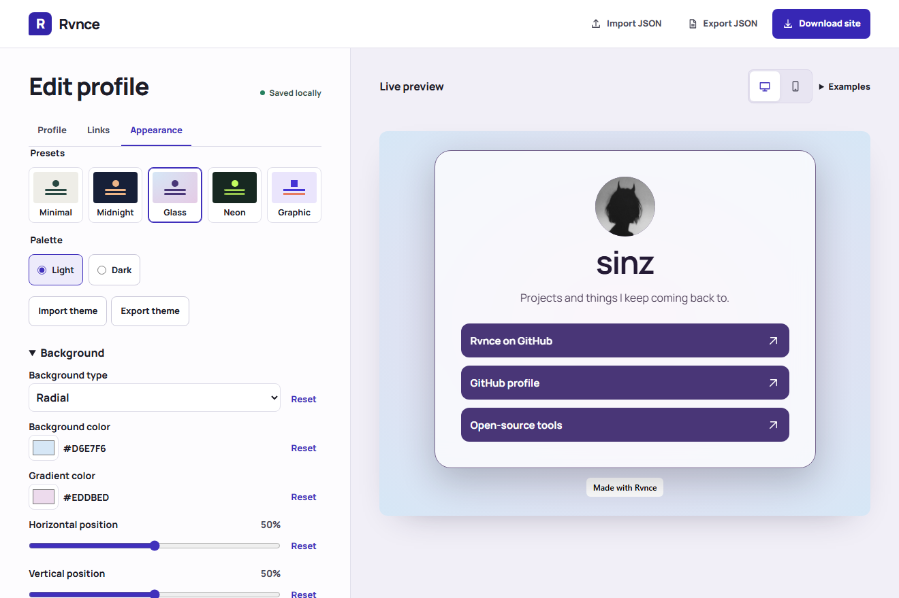
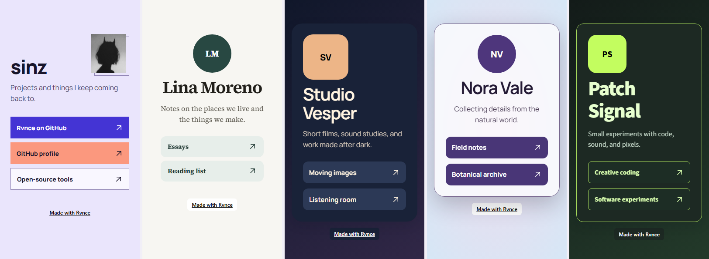

# Rvnce

[English](README.md) · [Русский](README.ru.md)

Rvnce — открытый конструктор персональных био-страниц. Выберите готовое оформление, настройте его под себя и скачайте статический сайт для самостоятельной публикации.

[Открыть редактор](https://sinzbtw.github.io/rvnce/) · [Graphic](https://sinzbtw.github.io/rvnce/demo/) · [Minimal](https://sinzbtw.github.io/rvnce/demo/minimal/) · [Midnight](https://sinzbtw.github.io/rvnce/demo/midnight/) · [Glass](https://sinzbtw.github.io/rvnce/demo/glass/) · [Neon](https://sinzbtw.github.io/rvnce/demo/neon/)

## Как собрать профиль

1. В **Profile** добавьте имя, описание, язык и фото. Подпись **Show Made with Rvnce** включена для новых профилей. Её можно бесплатно выключить или вернуть в любой момент.
2. В **Links** добавьте до 24 ссылок и расставьте их в нужном порядке.
3. В **Appearance** выберите пресет и светлую или тёмную палитру. Настройте фон, шрифт, карточку, аватар, ссылки и анимацию. Изменения сразу видны в предпросмотре. **Examples** открывает опубликованные примеры в отдельных вкладках.
4. Нажмите **Export JSON** для полной копии, **Export theme** для переноса оформления с фоном или **Download site** для публикации.

Rvnce хранит один черновик на origin браузера. Если другая вкладка изменила черновик, скачайте свои правки перед загрузкой сохранённой версии. Если хранилище недоступно, скачайте JSON перед закрытием редактора.

## Фоны и резервные копии

- Доступны цвет, линейный и радиальный градиенты, PNG, JPEG, WebP, GIF и H.264 MP4. Изображения до 8 МиБ масштабируются под сайт. GIF ограничен 3 МиБ и 240 кадрами, MP4 — 8 МиБ и 15 секундами. Предельное разрешение для GIF и видео — 1920 × 1080.
- У движущегося фона есть статичный постер и кнопка запуска или остановки. Если посетитель включил уменьшение движения или браузер заблокировал автозапуск, сначала виден постер. Если редактор не может открыть локальный MP4, можно загрузить изображение для постера. GIF и MP4 входят в экспорт с исходными метаданными и звуковой дорожкой, если она есть. Видео на странице играет без звука.
- Размер JSON профиля или темы ограничен 16 МиБ. Резервные копии профиля используют схему v3. При импорте v1 и v2 сохраняется графичное оформление, а подпись остаётся выключенной. Для v1 используется прежний язык по умолчанию `en`.

[Короткая демонстрация редактора](docs/images/appearance.gif).

## Локальный запуск

Понадобятся Node.js 24 и npm.

    npm ci
    npm run dev

Сборка для публикации и локальный предпросмотр:

    npm run build
    npm run preview

Чтобы разместить редактор и примеры, загрузите содержимое `dist/` в корень или подпапку статического хостинга.

## Как опубликовать профиль

Нажмите **Download site**, распакуйте ZIP и загрузите все файлы на статический хостинг. Держите рядом `index.html`, `profile.css`, `.nojekyll`, шрифты и медиа профиля.

На GitHub Pages положите файлы в корень репозитория профиля. В **Settings → Pages** выберите **Deploy from a branch**, укажите ветку и **`/ (root)`**, затем откройте адрес, который покажет GitHub. Относительные пути работают и в подпапке проекта.

Опубликованная страница обходится без серверного кода и не обращается к редактору. Текст, ссылки, статичные фоны и подпись работают без JavaScript. Для анимированного фона используется небольшой локальный плеер. При отключённых скриптах остаётся постер.

## Разработка и лицензия

Rvnce использует Preact, TypeScript и Vite. Предпросмотр, примеры и экспорт используют общий рендерер профиля. Vitest проверяет документы и экспорт, а Playwright — собранный редактор и опубликованные страницы.

См. [архитектуру](ARCHITECTURE.md), [участие в разработке](CONTRIBUTING.md), [планы развития](ROADMAP.md) и [безопасность](SECURITY.md).

Код распространяется по лицензии [MIT](LICENSE). Manrope, Source Sans 3 и Source Serif 4 распространяются по SIL Open Font License. В экспорт входит лицензия выбранного шрифта в `fonts/OFL.txt`.
